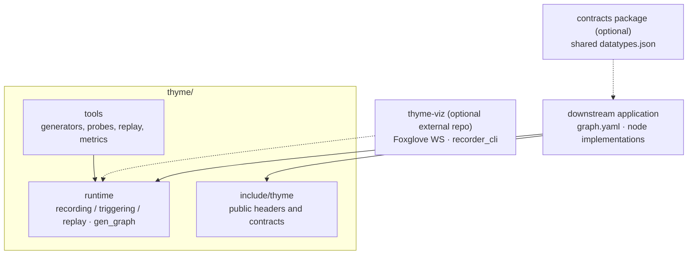
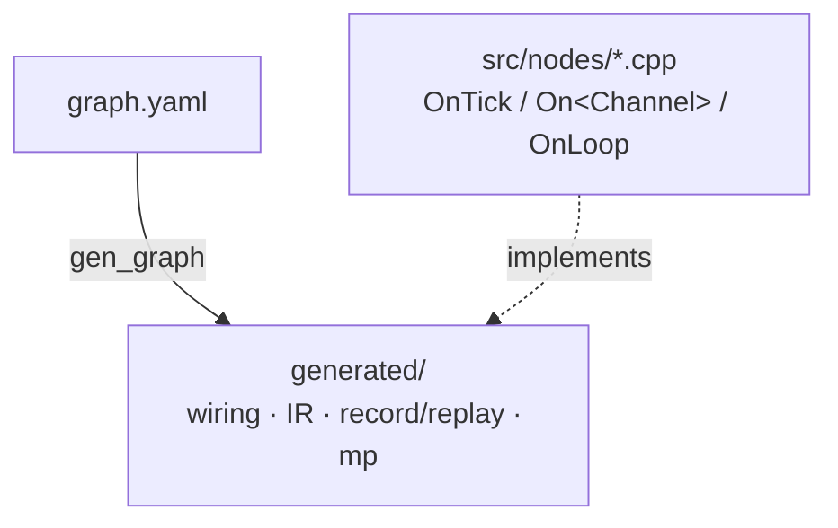
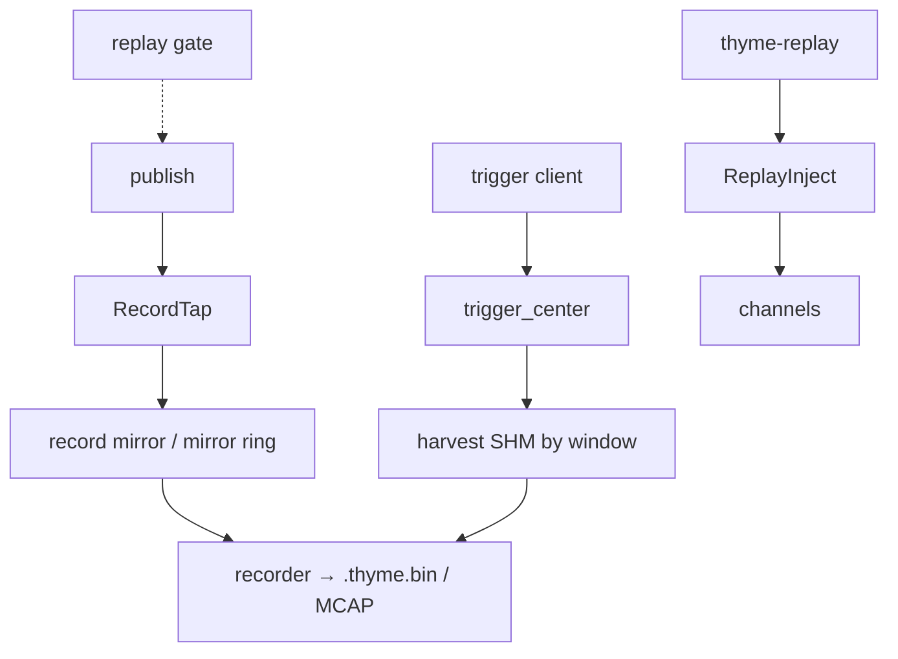

# thyme — Architecture

**Status:** 2026-11-02. Applies to this repository and its companion contracts
package. Build and test instructions are in [README.md](README.md).

---

## 1. One-page summary

thyme is a **fixed-topology, single-node** real-time data-plane runtime. The
graph is resolved at generation time, channel semantics are encoded in types,
small messages travel through shared memory, large frames use leases, and
recording, triggering, and replay run on side paths.

| Pillar | Choice |
|---|---|
| Topology | `graph.yaml` → `gen_graph` → `generated/`; no runtime discovery or registration |
| Process model | Single process with multiple threads, or `--mp` to split processes by the graph's `process` field; node = thread |
| Hot path | No DDS/ROS 2/ZMQ; rings, slots, leases, and futexes. Blocking waits appear only on wake paths |
| Small messages | In-process index handoff (`LocalIndexRing`), cross-process `ShmQueueRing`; copies occur only at SDK seams, cross-process shared memory, and side paths |
| Large frames | `PinnedSlotStore`: writer lease, reader pin, expiry reclamation; no whole-frame copy |
| Contracts | `datatypes.json` → plain POD plus a `Frame<T>` (40 B header) transport; no IDL |
| Execution | Cyclic nodes run one transaction per tick; event nodes wake on messages; no executor or callback group |
| Recording | Writer-side tap → record mirror → `.thyme.bin`; triggered capture harvests a time window from shared memory |
| Health | Per-thread `HealthSlot` plus a read-only supervisor view; a session lease answers "who is writing" |

For a comparison with ROS 2 and DDS, see the design notes in
[docs/design/api-docs.md](docs/design/api-docs.md).

---

## 2. Repository topology

This repository is self-contained. It contains the runtime, recording,
triggering, replay, observability tooling, and the `gen_graph` code generator.

| Component | Role |
|---|---|
| `thyme` core | Mechanism: runtime primitives, health, recording/triggering/replay, observability, `gen_graph` |
| Contracts package | Contract types and generator inputs; the shared source of `datatypes.json` |
| Downstream application | `graph.yaml`, hand-written nodes, adapters, trigger/recorder configuration |
| SDKs | Algorithms and drivers; they enter the data plane only through adapters |
| `thyme-viz` (optional) | Visualization and recorder frontend; related tool targets are skipped when absent, which is not an error |

A downstream application's `src/mp` and `src/support` directories are
**generated** (and git-ignored). They are produced from this repository's
scaffold with `scripts/generate.sh --update all`.

---

## 3. Mechanism vs policy

> The framework keeps **mechanism**; topology, thresholds, and policy belong to
> the application and the graph.

| Layer | Owns |
|---|---|
| `thyme` | Primitives, health, perf, recording mechanism, trigger protocol and FSM, MP control pages, `gen_graph`, ABI contracts |
| Application | `graph.yaml`, node implementations, SDK adapters, trigger/recorder configuration, deployment parameters |
| `thyme-viz` | Frontend and visualization; never part of the data plane |

`gen_graph` lives in the core because it emits **mechanism** (wiring, IR,
record/replay, MP glue). The graph itself is application policy.

---

## 4. Design principles

| Principle | Meaning |
|---|---|
| Fixed topology | Changing the graph means editing YAML, regenerating, and recompiling; there is no runtime topic discovery |
| Semantics in types | Retention, readers, overflow, and transport are compile-time parameters; mismatches fail at compile time |
| Zero-copy first | In-process index handoff; leases for large frames; copying is only an explicit backend choice |
| POD-only shared memory | Slots contain no pointers, strings, or virtual functions |
| Cyclic first | `CyclicThread` follows its declared `hz`; event nodes wake on messages |
| Visible failure | Overwrite, reject, pinned skip, and reader drops all have counters or state; `Publish` is `[[nodiscard]]` |
| Side-path isolation | Recorder, trigger, visualization, and replay never run inside `Loop()` |
| Auditable | Layout, version, and size are expressed with `static_assert` and capability tables, not comments |

---

## 5. Channels and transport

### 5.1 One facade, parameterized semantics

`Channel<T, Semantics, Backend>` (`include/thyme/runtime/channel.h`) exposes at
compile time:

- `kTransport`: `frame` or `pinned_slot`
- `kRetention`: `latest` / `queue`
- `kReaders`: `one` / `many`
- `kOverflow`: `overwrite` / `drop` / `reject`
- `Sample`: `ChannelFixedSample<T>` (copy) or a blob sample (lease)

The write side always uses `BeginWrite → fill → CommitWrite/AbortWrite`; the
read side always uses `TryRead → use → release`. **The lifetimes are not
unified, and must not be**: a copy sample is independent as soon as it is
returned, while a lease sample is valid until released. Merging them into one
runtime type would produce either fake pins or dangling pointers, so `Sample`
remains two types.

Generation-time `static_assert`s reject contradictory combinations
(`channel.h`):

- broadcast always implies `overwrite`;
- latest always implies `overwrite`;
- a shared-memory queue always implies `reject` (the producer sees a failure
  instead of silently overwriting);
- PinnedSlot always implies `drop` (the writer skips while all slots are
  pinned; it never blocks).

### 5.2 Transport and observability

| Transport | Location | On overwrite/full | Producer-visible | Consumer-visible |
|---|---|---|---|---|
| `LatestSlot` | In-process / cross-process | Keeps only the newest value | — | **Cannot** count; `skipped_*` applies only to drain-style inputs |
| `SpscRing` | In-process queue | Drops the oldest index | `drop_count` | Index gap / `drop_count` |
| `NotifPipe` | In-process notification | Drops the oldest when full | `Push` result | Batch drain |
| `ShmSpscRing` | Cross-process queue | `Push` fails | Return value / `push_fail_count` | No loss |
| `ShmSpmcRing` + `SpmcReader` | Cross-process broadcast | Overwrites the oldest slot | `overwritten` (whether this publish overwrote) | Per-reader `reader_drop_slots` |
| `PinnedSlotWriter` / `PinnedSlotReader` | Large frames | Skips while all slots are pinned | `pinned_skip`; expiry reclamation via `lease_steal` | Holes plus `FrameGap` in the packet |

The capability table `generated/channel_capabilities.json` records, per edge,
`transport_kind`, `retention`, `readers`, `overflow`, `recordable`,
`replay_gate`, `lease_required`, `hub_required`, `max_wire_bytes`, and
`slot_count`. Tools follow capabilities rather than branching on type names.
`tools/ci/channel_audit.py` enforces allowlists for `latest`, `reject`, and
single-slot PinnedSlot edges, and emits a "can the consumer observe it?" matrix.

### 5.3 Backend selection happens at generation time

An edge's semantics are fixed for a build. Whether it is cross-process or
in-process is determined by the graph's `process` layout and the contract size.
The same business code can run in SP and MP deployments, but **backend
differences must be read from the capability table**; they cannot be assumed.
`DualChannelRef<Local, Shm>` dispatches only to the backend selected at compile
time and returns `kUnbound` when unbound.

---

## 6. Execution model

### 6.1 Cyclic nodes: one transaction per tick

The generated `Loop()` has four fixed steps (ADR 0016):

1. Check the replay pause gate.
2. Read input edges: latest takes the newest frame; queue/IndexPipe/follow
   drain within budget and retain the last sample.
3. Call `OnTick(in, out)`.
4. Commit outputs marked `ready` and abort the rest; release input slots;
   failed queue pushes are counted in health.

`TickIn`/`TickOut` are generated from the edges. Fixed-size inputs are
`const Frame<T>*`; PinnedSlot inputs are `const uint8_t* + size`; outputs are
borrowed slots. Each input carries `skipped_<name>`: the number of old frames
released while draining. Pure latest inputs are always 0 (unknown, not "nothing
was lost"). Returning `false` suppresses all outputs for that tick.

### 6.2 Event nodes

`On<Channel>(sample)` wakes on messages, with an optional dispatch deadline;
multi-frame batches can be marked `span_multi`. An event node's `hz` is
**messages per second**, not a loop period. The supervisor's liveness gate uses
the process-wide minimum `hz`.

### 6.3 Do not pretend the models are symmetric

Cyclic and event nodes share some API names but not semantics: `NoteInFrame` is
last-wins in cyclic mode and first-wins in event mode; input waiting is an
optional AND-all in cyclic mode and a wake hub in event mode. Headers and
documentation describe both models separately; a generic "callback" abstraction
must not erase the distinction.

Scheduling: node = thread, serial callbacks, no executor or callback group
(ADR 0003). Placement is determined by `ThreadPlacement` and the generated
scheduling plan; RM/DM priorities are computed during generation.

---

## 7. Libraries and primitives

| Library | Responsibility | Headers |
|---|---|---|
| `thyme::runtime` | Threads, pools, rings, shared memory, latest, leases, health, perf/ProcSampler/host sampler | `include/thyme/runtime/` |
| `thyme::record` | Mirror, `.thyme.bin`, trigger center, quotas/audit, MCAP export | `include/thyme/record/` |
| `thyme::app` | `MpControl`, supervisor, session lease, status server, replay mode | `include/thyme/app/` |
| `thyme::replay` | Replay injection, pause/step/rate, replay gate | `include/thyme/replay/` |
| `thyme::probe` | Read-only page probing, ABI matrix, schema view | `include/thyme/probe/` |

Hot-path primitives:

| Type | File | Role |
|---|---|---|
| `ObjectPool<T,N>` | `object_pool.h` | FREE / WRITING / READY slots |
| `SpscRing` | `spsc_ring.h` | In-process index ring; `push_latest` drops the oldest, `push` fails when full |
| `NotifPipe<T,Cap>` | `notif_pipe.h` | In-process notification |
| `ShmSpscRing` | `shm_spsc_ring.h` | Cross-process lossless queue; producer fails when full |
| `ShmSpmcRing` | `shm_spmc_ring.h` | Cross-process 1:N overwrite; per-reader cursor and drop slot |
| `LatestSlot<T>` | `latest_slot.h` | Latest-value slot; seqlock with a 64-bit sequence |
| `PinnedSlotWriter` / `PinnedSlotReader` | `pinned_slot_store.h` | Large-frame leases, pins, expiry reclamation, footer validation |
| `CyclicThread` / `EventThread` | `cyclic_thread.h` / `event_thread.h` | The two worker kinds |
| `HealthSlot` / `SharedHealthPage` | `health_slot.h` / `shared_health.h` | Liveness and 64-bit drop counters |
| `FrameHeader` / `Frame<T>` | `contracts/frame_header.h` / `contracts/frame.h` | 40 B wire-format header plus generic framing |

### 7.1 Synchronization contract

"Lock-free" describes the **data plane** only:

- Data plane: slot access and publication are atomic reads/writes with
  acquire/release ordering; no lock is held while copying or publishing a
  payload. A slow consumer cannot hold a lock the producer needs.
- In-process waits: `LocalIndexRing`/`NotifPipe` wake paths use pthread
  mutex+condvar; `Notify` skips the lock when there are no waiters.
- Cross-process waits: shared-memory rings, PinnedSlot waiters, and the wake hub
  use `SYS_futex`; non-Linux platforms fall back to polling.
- Not end-to-end wait-free: a publisher may enter a futex, and consumer
  progress depends on scheduling. Latest/lease reads may retry a bounded number
  of times after a torn copy and then return "no value".

### 7.2 Framing and alignment

- Recording stores the **entire `Frame<T>` object** (`sizeof(Frame<T>)`), not
  `hdr.size`. `hdr.size` is the logical wire size
  (`FramePodWireBytes<Frame<T>> == sizeof(FrameHeader) + sizeof(T)`).
- Contract types use natural layout (no `alignas`) and remain byte-compatible
  with RTE/SDK consumers. False-sharing protection comes from container slots
  (64 B alignment units), not from the type.

---

## 8. ABI compatibility

Peers with mismatched versions are rejected during attach. The full
combination matrix and layout rules are in
[docs/reference/abi-compatibility.md](docs/reference/abi-compatibility.md).
`thyme_probe abi --matrix` prints the same constants, and
`tools/ci/check_abi_matrix.py` prevents drift.

<!-- abi-matrix:begin -->
| Component | Object | Constant | Version | Surface | Rule |
|---|---|---|---|---|---|
| app | `MpSessionIdentityPage` | `kMpSessionIdentityVersion` | 1 | SHM page `<prefix>_id` | Config/graph/health identity; missing means a legacy fallback with a warning |
| app | `SessionLeasePage` | `kSessionLeaseVersion` | 1 | SHM page | Topology writer lease; a live second writer receives `kBusy` and does not replace the holder |
| app | `MpControl` | `kMpControlAbiVersion` | 3 | SHM page | Super-header plus explicit `THYME_MP` magic; attach validates magic/abi/layout/page-bytes/features/reserved; v2 (bare version word) is rejected |
| app | `SharedHealthPage` | `SharedHealthPage::kVersion` | 3 | SHM page | Super-header plus health identity cell; attach validates magic/abi/layout/page-bytes/features/reserved and session id; v3 widens `drop_cnt` to 64 bits; v2 is rejected |
| pinned_slot | `PinnedSlotPageHeader` | `kPinnedSlotStoreVersion` | 4 | SHM page | Super-header (v4) over the `ProducerGate` body; the meta blob and slots append after the fixed prefix; v3 is rejected |
| pinned_slot | `PinnedSlotLeaseHeader` | `kPinnedSlotLeaseVersion` | 6 | SHM page `<channel>.lease` | Super-header (v6) plus copy-active/pid/start recovery; cells append after the header; v1..v5 are rejected |
| ring | `ShmSpscRing` | `kShmSpscRingVersion` | 4 | SHM page | Super-header (v4) plus `epoch_waiters`; v3 is rejected |
| ring | `ShmSpmcRing` | `kShmSpmcRingVersion` | 4 | SHM page | Super-header (v4) plus per-reader drop slots and a shared slot bitmap; v3 is rejected |
| latest_slot | `LatestSlot<T>` | `kLatestSlotLayoutVersion` | 3 | SHM page | v3 page: super-header plus a fixed 64 B geometry block (payload bytes/cell stride/slot count) before the unchanged body; legacy v2 body pages are rejected with no dual-read; locked by `LatestSlotLayoutModel<T>` |
| record | `RecordMirrorPage` | `RecordMirrorPage::kVersion` | 4 | SHM page | PID-scoped name; super-header (v4) plus keyed `ThymeStructDesc` entries; v3 is rejected |
| record | `RecordMirrorRingPage` | `RecordMirrorRingPage::kVersion` | 6 | SHM page | Own magic/version; a `ProducerGate` in each 128 B ring descriptor, fixed tables `192 + 256*N`, arena appended; v5 and earlier are rejected |
| record | `.thyme.bin` | `kThymeBinFileAbiVersion` | 4 | file | Readers accept v1..v4 (v1 has no footer index, v2 is indexed, v3 adds the manifest block and a 40 B legacy registry, v4 adds the 128 B keyed registry); v0 and future versions are rejected |
| record | `.thyme.bin` footer index | `kThymeBinIndexVersion` | 1 | file | Absent in v1 files, which are read sequentially |
| trigger | `TriggerRequest/TriggerResponse` | `kTriggerVersion` | 4 | AF_UNIX socket | v4 adds a nonzero `request_id`, bounded deduplication, and a new CRC; v1/v2 are rejected unless compatibility flags allow them; v3 keeps CRC/sequence without idempotent deduplication |
| evidence | `integrity.manifest` | `kManifestVersion` | 1 | file | Read-only evidence; unknown flags are rejected; not a mixed-run ABI |
| perf | perf log | — | — | file | No version word; append-only, and an unknown block type ends the parse |
<!-- abi-matrix:end -->

As-built gaps that the matrix cannot express (pages without a version word,
gates covering only one transport, and similar cases) are recorded in
[docs/reference/as-built-deviations.md](docs/reference/as-built-deviations.md).

---

## 9. Codegen seam

- Generated `Loop()`/`Dispatch()` bases are `final`; replay pause and record
  taps are built in.
- `health_reporter` must be the last node in the YAML (`graph_check.h`).
- After every `--update generated`, read the application's
  `generated/integration.md`.
- `--check` regenerates into a staging directory and compares byte-for-byte,
  preventing manual edits to generated artifacts.

Workflow: [INTEGRATION.md](tools/gen/gen_graph/INTEGRATION.md); schema and CLI:
[gen_graph README](tools/gen/gen_graph/README.md).

---

## 10. Side paths

### 10.1 Recording

Writer-side taps write frames into the record mirror: page header,
`ThymeStructDesc` table, per-slot seqlock header, and a shared payload arena
(2 MiB). `payload_offset/capacity` is written before the `magic` release-store,
so a reader that passes `Validate()` sees a complete table. Writes larger than
a slot increment `oversize_drop_cnt` and warn once. Triggered capture uses a
separate per-struct `RecordMirrorRing`, with slot counts derived from rate and
window.

### 10.2 Triggered capture

`trigger_center` communicates over an AF_UNIX socket (v4 protocol:
`request_id`, deduplication, CRC). The FSM covers
pending/running/preempted/completed/cancelled/preempt-failed. The window is
`before_s`/`after_s` (default 10/5); large frames are pinned, gaps are written
as `FrameGap`, and an incremental hash is computed after sealing. Quotas, quiet
periods, preemption, auditing, cut/slice behavior, and `.incomplete` handling
are configuration-driven ([trigger-config.md](docs/guides/trigger-config.md)).

### 10.3 Replay

`thyme-replay` injects a package into the same channels; `pause/step/rate`
follow the recorded timeline. The replay gate in the channel header pauses
producers during replay while consumer behavior is unchanged. Format and tools
are described in [replay.md](docs/guides/replay.md).

---

## 11. Multi-process

The supervisor is a long-lived process, one per image. It forks/execs roles
according to the graph's `process` field, prepares shared memory
(latest/queue/broadcast/pinned/health/control/mirror), performs `waitpid` on
each tick, detects stalls, optionally restarts roles (off by default), and
unlinks resources on exit. Roles only open existing resources.

- `MpControl`: per-process loop counters, cross-process frame gates, trigger
  relay, and the status endpoint.
- Session identity page plus session lease: answers "which configuration/graph
  is this and who is writing"; mixed versions and dual writers are rejected.
- The supervisor also writes the host-wide sample file
  `<prefix>_host_<pid>.bin`.

Operational steps: [docs/guides/orchestration.md](docs/guides/orchestration.md).

---

## 12. Observability

| Layer | Mechanism |
|---|---|
| perf log | Ten block families: sample / percentile / work / epoch / sys / histogram / manifest / series-name / node-budget / clock-anchor |
| Process resources | `ProcSampler` exposes 16 fixed series on a dedicated 1 Hz thread; the hot path performs no `/proc` access |
| Optional sources | `THYME_PROC_EXT`: cgroup v1/v2, PSI, disk/network, registered threads; capability bits in `ext_caps` |
| Host-wide | `HostDumper`: overall and per-core CPU, load, memory, and the system fd table, written to `<prefix>_host_<pid>.bin` |
| Aggregation | `thyme_log_merge` (timeline/`--hist`/`--sys`), `thyme_metrics_exporter`, `thyme_probe` |
| Gates | `channel_audit.py`: latest/reject/single-slot pinned edges must be allowlisted; emits an observability matrix |

Histograms and raw samples coexist because the ring keeps only the recent
window, while a histogram covers the **entire run** (`Reset` happens only after
a dump) and can be merged bucket-wise across processes. Details:
[perf.md](docs/usage/perf.md) and
[observability-dashboards.md](docs/guides/observability-dashboards.md).

---

## 13. Capacity limits

| Item | Value | Impact |
|---|---|---|
| `Frame<T>` transport | 65535 B | Larger payloads must use PinnedSlot |
| Record payload | 512 KB | `.thyme.bin` / mirror |
| Mirror arena | 2 MiB | Sum of all channels |
| Threads per process | default 64, 1..1024 | `THYME_ABI_MAX_THREADS`, included in the health page hash |
| Contract kinds | default 64, 1..1024 | `THYME_ABI_MAX_STRUCT_COUNT`, included in mirror/`.tbin` identity |
| Broadcast readers | 8 | Fixed; changing it moves the SPMC payload offsets |
| Wait inputs | event 32 / cyclic 8 | Shared by graph validation |
| Host cores | 64 | Additional cores are folded into the total row |

Changing the build-time profile changes the page identity hash; mixed-version
attach is rejected at `layout_hash` and never falls back to dual-read.

---

## 14. Status

The core has converged on: ABI page headers and mixed-version rejection, a
single lease path, trigger FSM/audit/quotas, incremental hashing and crash
recovery, a unified `Channel` facade and tick transaction, observability
(perf/resources/host/channel audit), and byte-stable generator goldens with
`--check`.

Known gaps are intentionally out of scope for this repository: hardware-in-the-
loop soak testing, diagnostics/UCM/time-synchronization platform services, and
target-board performance sign-off. Do not replace this context with a
"completion percentage" in documentation.

---

## 15. Further reading

| Document | Content |
|---|---|
| [README.md](README.md) | Clone, build, test, quick start |
| [docs/usage/index.md](docs/usage/index.md) | User manual (API, tools, topics) |
| [docs/reference/glossary.md](docs/reference/glossary.md) | Ring/slot/lease/seqlock/epoch/watermark/trigger FSM |
| [docs/reference/scheduling-model.md](docs/reference/scheduling-model.md) | node=thread, serial callbacks, placement |
| [docs/reference/abi-compatibility.md](docs/reference/abi-compatibility.md) | Full ABI matrix |
| [docs/reference/as-built-deviations.md](docs/reference/as-built-deviations.md) | Design claims vs implementation, with status |
| [docs/guides/test-matrix.md](docs/guides/test-matrix.md) | Which suite runs in which CI job |
| [docs/guides/runbook.md](docs/guides/runbook.md) | Disk full / SHM leaks / trigger storms / crash recovery |

When changing a transport, a YAML field, or a generated artifact, update **this
file**, the README, and the affected guides in the same change.
