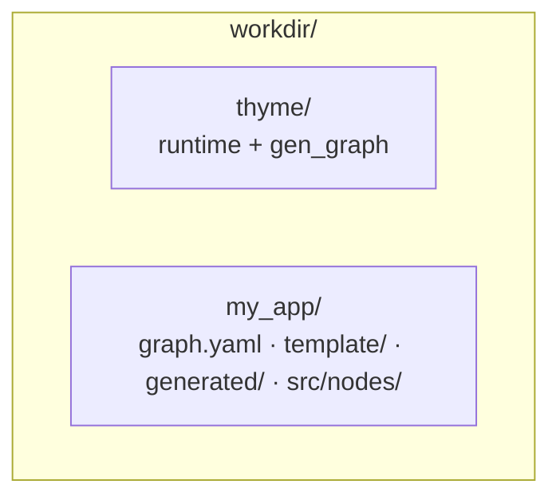

# gen_graph integration guide

**Architecture background:** [ARCHITECTURE.md](../../../ARCHITECTURE.md)

**Applies to all thyme projects.** After each regen, read the parts related to the
**current graph**: node I/O, recorder topics, viz allowlist, mp SHM, etc.:

```text
generated/integration.md    ← generated from graph.yaml; do not hand-edit
```

> Division of labor: `graph.yaml` = topology contract; `gen_graph` = wiring and
> recording/replay glue; `src/nodes/` = algorithms; `include/.../contracts/` =
> **bare payload structs** (no injected header; framing is handled by
> `thyme::Frame<Payload>` in the transport layer).

---

## 1. Documentation map

| Document | Scope |
|------|------|
| [README.md](README.md) | CLI, `--update`, yaml fields, recorder parameters |
| **This document** | Integration workflow, SDK rules, verification matrix |
| **`generated/integration.md`** | Nodes for this graph, RecordTap, example commands, manual checklist |
| `template/integration_hints.txt` | SDK notes in the project overlay |
| [thyme README](../../../README.md) | Runtime / event primitives |

---

## 2. Recommended directory layout



---

## 3. Integration workflow

### 3.1 New project

```bash
cmake -S thyme -B thyme/build && cmake --build thyme/build --target gen_graph
# 1) contracts (datatypes.json → include/<ns>/contracts/types.h + contracts_json.h
#    + template/contracts_include.txt + template/contracts_json.txt (viz declarations)
#    + template/contract_sizes.txt (size/transport-limit checks))
python3 thyme/tools/gen/gen_contracts/gen_contracts.py --in my_app/datatypes.json --out my_app
#    -> include/<ns>/contracts/{types.h,thyme_types.h,contracts_json.h,
#       contract_layout.h} + template/{contracts_include,contracts_json,
#       contract_sizes,contracts_layout}.txt
# 2) Derive the Group 1 templates (graph.yaml → template/)
gen_graph --in my_app/graph.yaml --out my_app --derive-template --project-name my_app
# 3) Generate + scaffold
gen_graph --in my_app/graph.yaml --out my_app --template-dir my_app/template --update all
cmake -S my_app -B my_app/build -DTHYME_SOURCE_DIR=$PWD/thyme
cmake --build my_app/build
```

- [ ] Read **`generated/integration.md`** and implement `src/nodes/` according to its checklist
- [ ] Prepare `include/.../contracts/` (`gen_contracts.py` generates it from `datatypes.json`)

`datatypes.json` requires top-level `frame_magic` (4 ASCII characters, e.g.
`"ABCD"`) and `frame_version` (an integer). The generated `types.h` exports
`kFrameMagic`/`kFrameVersion` and the **bare payload structs** (fields are the
`fields` from `datatypes.json`, with no injected header, **natural layout**, and no
`alignas` — byte-compatible with RTE/SDK types; cacheline isolation is the container
slots' responsibility; `bytes` is the payload-only size in natural layout). A type
may declare `"layout_of": "ns::ReferenceType"`, which generates an optional
`layout_checks.h` (static `sizeof`/`offsetof` assertions against that reference
type, active in a TU that defines `THYME_LAYOUT_CHECKS` and includes the reference
header). `FillStub` = `thyme::FrameInit(...)` + `thyme::FrameSeal(...,
kFrameMagic, kFrameVersion)`. Recording/replay/viz and pool/transport all carry
`thyme::Frame<Payload>`, and the recorded size is `sizeof(Frame<T>)`.

**Template model:** effective template = thyme's built-in `scaffold/` ∪ the project
**`template/`** overlay. An overlay at the same path overrides the base; without
`--template-dir`, only the base is used. The Group 1 tables in `template/`
(`pools.txt`, `contracts.txt`, `known_types.txt`, `channel_defaults.txt`,
`shm_kinds.txt`, `graph_types.h.inc`, `mp_includes.inc`) are derived from
`graph.yaml` by `--derive-template` and need not be written by hand.

#### Upgrading an existing project after a gen_contracts update

After upgrading the generator in an existing project, you **must** explicitly
regenerate everything with `--force`, then run `--check`; without `--force` it
refuses to overwrite existing output. `--check` only validates the input and lists
the planned outputs; it does not write files and does not compare existing artifacts
for staleness. Additional flags used during generation (`--with-fill-stub`,
`--autosar-types`, `--graph`, etc.) should be kept consistent.

Run from the repository root (containing `thyme/` and `my_app/`):

```bash
python3 thyme/tools/gen/gen_contracts/gen_contracts.py \
  --in my_app/datatypes.json --out my_app --force
python3 thyme/tools/gen/gen_contracts/gen_contracts.py \
  --in my_app/datatypes.json --out my_app --check
```

Or run from the project directory `my_app/`:

```bash
python3 ../thyme/tools/gen/gen_contracts/gen_contracts.py \
  --in datatypes.json --out . --force
python3 ../thyme/tools/gen/gen_contracts/gen_contracts.py \
  --in datatypes.json --out . --check
```

Contracts that exist only as hand-written `.h` files, with no `datatypes.json`,
cannot run the commands above. If a hand-written contract has no
`template/contract_sizes.txt`, gen_graph has no schema size copy, so the 64 KB
transport limit exists only as a compile-time assert in the generated app; the
**64 KB diagnostic with `file:line`** in the generated app depends on that file.
Likewise, without it no `sizeof(T) == <schema bytes>` size-drift assertion is
generated, but the `FramePodWireBytes<Frame<T>>` compile-time transport check is
still present.

### 3.2 After changing the graph

```bash
gen_graph --in graph.yaml --out . --update generated [--template-dir template]
```

- [ ] Re-read **`generated/integration.md`**
- [ ] Rebuild; do **not** hand-edit `generated/`

`generated/` is **atomically rewritten**: the whole tree is generated in a
pid-unique staging directory and then renamed into place; a crash mid-way leaves no
half-written tree, and stale files from the old graph are deleted. Before
committing/in CI, use `gen_graph --check` (with the same arguments as generation) to
confirm that `generated/` is in sync with the yaml.

Every full generation also writes **`generated/.gen_meta.json`**: tool name,
generator semantic version, output format version, and source graph hash. It belongs
to `generated/`, and `--check` byte-compares it like any other file; on a
version/format mismatch, `--check` exits 1 with a migration diagnostic (see §3.5).

For **topology changes** (adding/removing pools/nodes/edges/processes), re-derive
the Group 1 templates first, then regen:

```bash
gen_graph --in graph.yaml --out . --derive-template [--template-dir template] [--force]
gen_graph --in graph.yaml --out . --update generated --template-dir template
```

### 3.3 Changing algorithms only

Editing only `src/nodes/*.cpp` → **no** regen is needed (unless the yaml topology,
types or edges changed).

### 3.4 `--update` choices

| Scenario | Mode |
|------|------|
| Change yaml topology/Hz/processes/edges | `generated` |
| New node type needs a stub | `nodes` (existing files are not overwritten unless `--force`) |
| First-time app tree | `app` or `all` |
| Refresh mp tables | `mp` |

### 3.5 Versions, generated metadata and migration

Versions have two dimensions, both written into `generated/` by the generator:

| Version | Meaning | Location |
|------|------|------|
| Generator semantic version | The `gen_graph` binary itself (`MAJOR.MINOR.PATCH`) | `meta.h`, `.gen_meta.json`, banner of every generated file |
| Output format version | Structure/contract of `generated/` (currently **3**) | `meta.h`, `.gen_meta.json`, banner |
| Source graph hash | 16-hex FNV-1a of the effective graph (including the default `health_reporter` injection); ignores yaml paths and line numbers | `.gen_meta.json`, `kGraphHash` in `graph_ir.h` |

```json
{
  "tool": "gen_graph",
  "generator_version": "3.11.1",
  "format_version": 3,
  "source_graph_hash": "697c6370a7d89ac9"
}
```

`generated/graph_ir.h` writes the same hash as a non-zero
`inline constexpr uint64_t kGraphHash`. The generated supervisor sets
`cfg.graph_hash = kGraphHash`, and every role calls
`MpRoleSession::Open(..., 0, /*record_ring=*/true, kGraphHash)`, so the supervisor
and roles validate the same graph identity. An FNV-1a result of 0 fails generation;
0 is reserved only for the legacy six-argument runtime path, and generated code
never uses it to skip graph validation.

```bash
gen_graph --version
# gen_graph 3.11.1 (output format 3)
```

Generated files carry the same version stamp at the top, including `.inc` files
with their own header and `integration.md`:

```text
// Code generated for the ports fixture graph. DO NOT EDIT.
// gen_graph 3.11.1 (output format 3)
```

**Migration rules (authoritative description in [README § Versioning, generated metadata and migration](README.md#versioning-generated-metadata-and-migration)):**

- `generated/` is always rewritten in full by the generator, with **no manual
  migration path**. A format upgrade = a full regen; `--check` never declares a tree
  produced by another format/version up to date.
- **Compatibility window = the current format**: the generator understands only the
  format it produces. Old trees are replaced wholesale; one app must not mix
  `generated/` trees of different formats.
- Generator version drift within the same format (bug fixes/template changes) may
  change output bytes and is likewise resolved by a full regen, still gated by
  `--check`.
- **`--force` does not affect `generated/`** (it only overwrites user files for
  `nodes`/`app`/`all`, or derived files for `--derive-template`); a stale tree does
  not need and does not accept `--force`.
- **`--update mp`** refreshes only `graph_ir.h` + `mp_unknown.h`, does not rewrite
  the meta, and is not a migration path; when the format already matches it can be
  used for a quick refresh, after which `--update generated` should still be run.
- Rollback = `git revert` the generator and `generated/` together; reverting only
  one side leaves the meta/banner inconsistent, and `--check` keeps failing until
  the pair is regenerated.

**Format-upgrade migration steps:**

```bash
cmake --build build --target gen_graph
gen_graph --in graph.yaml --out . --template-dir template --update generated
git diff --stat -- generated/
gen_graph --in graph.yaml --out . --template-dir template --check
# Commit graph.yaml (if changed) + generated/ together
```

---

## 4. Execution model: cyclic and event

### 4.1 Cyclic (default)

- The node has no `exec`, or `exec: cyclic`
- **`CyclicThread`** calls **`OnLoop()`** at the `hz` period
- Same-process edges: `ObjectPool` + `SpscRing` (latest, may drop old)
- Cross-process edges: `LatestSlot` + `shm` suffix

### 4.2 Event (`exec: event`)

- **`EventThread`** calls **`Dispatch()`** when a **`Waitable`** input is ready
- Hand-write **`On<Channel>(const T&)`** (one handler per in-edge)
- **`wait_inputs` is forbidden**
- **`hz`** = expected steady-state **messages/s** (the same order as `NoteHandled`),
  **not** the Loop period

### 4.3 Edge `delivery`

| delivery | Primitive | Scenario |
|----------|------|------|
| `latest` | LatestSlot / in-process SpscRing | → cyclic node |
| `notify` | NotifPipe | Same process → event |
| `queue` | ShmSpscRing + wake | Cross-process → event |
| `broadcast` | ShmSpmcRing + SpmcReader | Cross-process 1:N overwrite without backpressure; **must be written explicitly** (not derived from process/exec) |

`latest` / `notify` / `queue` may be omitted and are derived from
`(from.process, to.process, to.exec)`. `broadcast` **cannot** be omitted; otherwise
a cross-process cyclic edge stays `latest` → LatestSlot. `broadcast` is allowed only
across processes, must have `shm`, and forbids `pool` / `mp_gate`; fan-out over the
same `shm` must use the same **effective Cap** (`depth` or `ring_cap`). In a single-process
build, a cross-process-semantics `queue` may degrade to an in-process `NotifPipe`;
**`broadcast` has no in-process path**, so the graph must contain multiple processes
and the app must run in `--mp` mode (`--mp` is a run-mode switch of the generated app
binary, not a gen_graph argument).

**Edges into event nodes** usually have **no `pool`** (pipe/queue). **`broadcast`
edges also have no `pool`** (the payload lives in the ring). An in-proc `latest`
edge into a cyclic target still needs a pool.

---

## 5. yaml extension fields (authoritative in gen_graph)

The graph dialect is defined by `LoadGraphYaml`. Do **not** use an editor that does
not understand `broadcast` / `read` to save a graph containing them (Save drops the
fields and breaks the shared shm).

| Field | Location | Status |
|------|------|------|
| `exec: event` | node | Fully supported by gen_graph |
| `publish: on_all_inputs` | node | Parsed + `--explain-rates`; fusion/decision can infer it by default |
| `delivery` | edge | Parsed + emitted; `broadcast` must be explicit |
| `read` | edge | `broadcast` only: `latest` \| `follow` (omitted = latest) |
| `depth` | edge | queue / notify / **broadcast**; effective `Cap = depth > 0 ? depth : ring_cap`. DEPTH_WARN still applies only to notify/queue |
| `feedback` + `delay` | edge | Explicit loop closure. A directed cycle is allowed only with `feedback: true` and `delay` > 0 (ns); the edge is cut for DAG validation and rate derivation, and `--explain-rates` reports each one under `loop_unresolved` |

After loading and before any emit, `ValidateGraphSemantics` performs **semantic
validation**: duplicate ids, dangling endpoints, channel/type conflicts, illegal
identifiers, missing shm kind, etc. are reported line by line, exit 2, with no
partial output. Validation derives rates (without changing artifacts):

```bash
gen_graph --in graph.yaml --explain-rates
```

---

## 6. General SDK integration rules

Applies to **`OnLoop()`** (cyclic) or **`On<Channel>()`** (event). The generated
base class's **`Loop()`/`Dispatch()` are final**, with built-in replay pause and
mirror page capture.

| Rule | Description |
|------|------|
| Seam inside the handler | SDK → `acquire()` → write POD → `publish()`; SDK pointers must not enter a ring |
| Lifetime | Read a pool slot only between pop and `release()` |
| 1→N | A single SPSC edge does not support multiple subscribers; a second pool or SHM is required |
| Recording | Call the base class `RecordTap(id, v)` **after `publish()`**. Only channels with `record: true` have a `RecordStructId`/tap; in-process transport for unrecorded edges is still generated |
| manifest | `generated/record_manifest.h` is the single ordered table of recorded channels (ascending by channel name); changing the recording allowlist is an ABI change — inspect the diff/hash after regen and do not hand-edit |
| schema/manifest output | `generated/record_table.h` exports `GetThymeRecordTable().manifest` (`kRecordManifestHash` + version + `contract_layout.h` lookup). The recorder host forwards it to `triggered::Config::record_manifest`, so packages carry the manifest block and the field-level `schema.json`; without this wiring recording still works, and the sidecar declares the layout unavailable |
| Trigger | Module `record_trigger::Request` → supervisor relay; do not call the recorder inside Loop |
| Change channel/type | Change the yaml → regen → update `config/viz/viz.yaml` |

`integration_hints.txt` can append per-type manual steps → written to
**`generated/integration.md`**.

**Supervisor liveness:** `MinLoopsForProcess` uses the process **min hz** × seconds
/ 4, and does not require event nodes to hit the declared messages/s.

---

## 7. Multi-process (mp)

- The supervisor creates SHM before fork (v3 described LatestSlot pages, control,
  health, optional RecordMirror, event queue/wake); the LatestSlot region size,
  payload identity and create/open callbacks come from `kGraphShmKindSpecs`
  (`LatestSlotLayoutModel<T>`) in `generated/shm_slots.h`, and roles attach with the
  same table
- Workers are assembled via **`RunRole(role, …)`** + the generated
  **`AssembleRoleLocals`**
- `health_reporter` must be the **last node** in the yaml (it occupies the last
  health slot and monitors the first N−1 worker slots)

See the app's **`generated/integration.md`** mp table for details.

---

## 8. Verification matrix

### 8.1 thyme repository (gen_graph / runtime)

```bash
ctest --test-dir thyme/build -R 'test_gen_graph|test_empty_app' --output-on-failure
ctest --test-dir thyme/build -R 'test_notif_pipe|test_event_thread|test_shm_spsc_ring' --output-on-failure
```

### 8.2 Application repository (example)

| Level | Command | Description |
|------|------|------|
| Fast | `ctest -L unit` | PR gate |
| Linux integration | `ctest -L 'integration;linux'` | Requires SHM |
| Slow / event-twin | `ctest -R test_ev_chain_compare` | Event-chain byte comparison |
| Full | `ctest` (main-branch CI) | Includes slow/bench |

See the end of **`generated/integration.md`** for suggestions for this graph.

---

## 9. AI / automation agents

1. Read **`graph.yaml`** + **`generated/integration.md`** (do not read only this generic INTEGRATION guide)
2. Change only **`src/nodes/`**, contracts, config/viz
3. After regen, diff **`generated/integration.md`**
4. Do not bulk-edit `generated/*.h`; on golden failures, fix the yaml/emit and
   regenerate; CI uses `gen_graph --check` (with the same arguments as generation)
   to detect stale/hand-edited `generated/` (exit 1 with a per-file diff); a
   format/version drift in `generated/.gen_meta.json` also exits 1 (see §3.5)
5. Do not save product yaml with an editor that does not understand the current
   dialect. New fields go only into gen_graph; there is no fixture-sync path back
   into an older editor.

---

## 10. Related links

- [README.md](README.md) — authoritative CLI and schema documentation
- [thyme README](../../../README.md)
