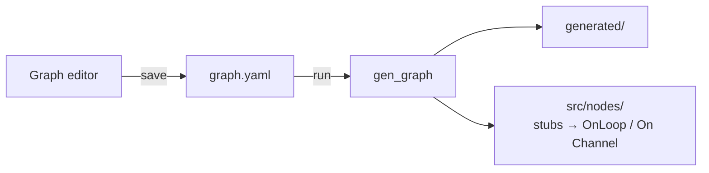

# gen_graph

Host-side **graph code generator**. Architecture context: [ARCHITECTURE.md § Codegen seam](../../../ARCHITECTURE.md).

Reads `graph.yaml`, emits `generated/` wiring and scaffolds `src/nodes/` from **scaffold/** + optional `--template-dir` overlay.

Does **not** link `thyme::runtime`.

Build:

```bash
cmake -S ../.. -B ../../build
cmake --build ../../build --target gen_graph
# → ../../build/tools/gen/gen_graph/gen_graph
```

---

## Role in the stack



1. Author topology (editor or yaml).
2. **Save** / validate yaml.
3. Run `gen_graph` with the right `--update` mode.
4. Implement handlers in `src/nodes/*.cpp`; never hand-edit `generated/`.
5. Build app CMake project linking `thyme::runtime` (+ recorder/app as needed; viz and the recorder CLI come from the optional **thyme-viz** sibling).

Optional: clone **thyme-viz** as a sibling for Foxglove viz + recorder CLI; without it, `viz_bridge` / `recorder` tool targets are skipped.

Per-graph recorder topics, replay stages, mp SHM table: **`generated/integration.md`** (regenerated each time).

Generic workflow: **[INTEGRATION.md](INTEGRATION.md)**.

---

## CLI

```text
gen_graph [--in PATH] --out DIR [--update MODE] [--template-dir DIR] [--force] [--explain-rates]
          [--explain-sched] [--sched-priority=MODE] [--sched-admission=MODE]
          [--sched-capacity=MODE] [--check] [--no-health-reporter] [--health-hz HZ]
gen_graph --in graph.yaml --emit-json
gen_graph --from-json graph.json --emit-yaml
gen_graph --from-json graph.json --out DIR [--update MODE] ...
gen_graph --in graph.yaml --derive-template [--template-out DIR] [--project-name NAME] [--contracts-include PATH] [--force]
gen_graph --version
```

| Flag | Meaning |
|------|---------|
| `--in PATH` | Input yaml. Required except `--update all` with missing `OUT/graph.yaml` (bootstrap from template). |
| `--from-json PATH` | Read the canonical JSON graph (see *Canonical JSON* below) instead of `--in`. Mutually exclusive with `--in`; the same generation/`--check` flags apply. |
| `--emit-json` | Parse `--in` yaml and print the canonical JSON graph to stdout; **exit 0 without emitting files**. |
| `--emit-yaml` | With `--from-json`, print canonical `graph.yaml` for the JSON graph to stdout; **exit 0 without emitting files**. |
| `--out DIR` | App root. Defaults to `--in`'s directory. |
| `--update MODE` | `generated` (default), `mp`, `nodes`, `app`, `all` — see below. Day-to-day edit = `generated`; greenfield bootstrap = `all`. There is **no `init`** command. |
| `--template-dir DIR` | Project **overlay** on built-in `scaffold/`. Merged view = base ∪ overlay (overlay shadows same path). |
| `--force` | With `nodes`/`app`/`all`: overwrite existing node stubs / app skeleton (destructive). With `--derive-template`: overwrite existing derived files. |
| `--explain-rates` | Parse yaml, print derived rate JSON to stdout, **exit 0 without emitting files**. |
| `--explain-sched` | Parse yaml, print the scheduling/admission report: JSON to **stdout** (byte-stable) and the human table to **stderr**; **exit 0 without emitting files**. Exit **2** on priority-policy errors, `--sched-admission=error` overload, or `--sched-capacity=error` insufficient/unknown capacity. Incompatible with `--derive-template` / `--explain-rates` / `--check`. |
| `--sched-priority=MODE` | `best-effort` (default) or `strict`. Cyclic nodes get rate-monotonic priorities; event nodes (hz = messages/s) have no period. `best-effort` keeps default 10 + `SCHED_WARN`; `strict` makes that a generation error. |
| `--sched-admission=MODE` | `error` (default), `warn`, or `off`. Per-core `Σ C_i/T_i > 1.0` is an error under `error`, a warning under `warn`; `> 0.9` warns in both. Missing `wcet_ns` is reported as `partial`/`not_analyzed`, never treated as zero. |
| `--sched-capacity=MODE` | `error` (default) or `best_effort`. Validates lossless queue/ring depth and pin-window capacity. `best_effort` explicitly downgrades insufficient or unprovable capacity to a marked warning; it does not change WCET admission. |
| `--check` | Regenerate into a staging dir and **byte-diff against `OUT/generated/`**; exit **1** (naming every differing/missing/stale file) when the checked-in tree is stale or hand-edited, exit 0 when up to date. Writes nothing outside the staging dir. Only valid with `--update generated` (the default); incompatible with `--derive-template` / `--explain-rates` / `--explain-sched`. Use the same flags (`--template-dir`, `--no-health-reporter`, …) as the generation being checked. Also fails on cross-format/cross-version metadata (see below). |
| `--version` | Print the generator semantic version and the generated output format version, then exit 0. Reads no graph and needs no `--in`/`--out`. |
| `--derive-template` | Derive the Group 1 template overlay (catalog tables + fragments) from `graph.yaml`; exit 0 without emitting app code. Incompatible with `--update` / `--explain-rates` / `--explain-sched`. |
| `--no-health-reporter` | Do **not** inject the default `health_reporter` aggregator (see below). |
| `--health-hz HZ` | hz for the injected `health_reporter` (default `10`, must be > 0). |
| `--template-out DIR` | Output dir for `--derive-template`. Defaults to `<out>/template`. |
| `--project-name NAME` | Optional banner for `--derive-template` → `banner.txt` (and the `graph_types.h.inc` header). |
| `--contracts-include PATH` | Fallback contracts header path for `--derive-template`, used only when `<template-out>/contracts_include.txt` is absent. |

On success: `nodes=N pool_n=P ring_cap=R`. Parse/usage/validation errors: exit **2**. `--check` drift (stale or hand-edited `generated/`): exit **1**.

Diagnostics name the source line: parse and semantic-validation errors print
`<yaml path>:<line>: <message>` (cycle rejections name the line of the
loop-closing edge). Emit-stage failures (template catalog mismatches) print
`EmitGenerated: …` / `gen_graph: …` naming the offending edge and channel; they
carry no yaml line because the graph itself is well-formed.

**Default aggregator injection.** Unless `graph.yaml` already declares a
`health_reporter` node (or `--no-health-reporter` is given), the codegen and
scaffold path (`--update generated` / `mp` / `nodes` / `app` / `all`) appends a
synthetic `health_reporter` node as the **last** node and bumps `health_n` to
cover it. It is a `noworker` aggregator: it owns no data edges and borrows the
worker health slots (see `health_reporter_generated.h.inc` + the
`HealthReporterThread` scaffold). This lets a `datatypes.json`-only generator
(which knows nothing about the aggregator) drive `graph.yaml` while the default
aggregator still exists in every generated project. `--derive-template` and
`--explain-rates` reflect `graph.yaml` as-written and are unaffected.

**Not implemented:** `--process` (rejected, exit 2). There is no `init` mode — `--update all` is the bootstrap path.

---

## `--update` modes

| Mode | Writes | Use when |
|------|--------|----------|
| `generated` | Full `generated/` tree + **`integration.md`** | **Daily edit** — after a yaml change; Loops unchanged |
| `mp` | `graph_ir.h`, `mp_unknown.h` only | Refresh mp tables |
| `nodes` | `src/nodes/<id>.{h,cpp}` stubs | New node types |
| `app` | `src/main.cpp`, CMake, tools, contracts stub | First app skeleton |
| `all` | All of the above + copy `src/support/`, `src/mp/` from template view | **Greenfield only** — new project (`OUT/graph.yaml` created if missing) |

Rule of thumb: `--update generated` is the everyday command; `--update all`
bootstraps a new project and is **not** meant for routine edits.

**Atomic rewrite:** `generated/` is fully generator-owned, so
`--update generated` / `all` rewrite it **atomically**: the fresh tree is
staged in a pid-unique sibling dir (`.generated.tmp.<pid>`), the old tree is
renamed aside (`.generated.trash.<pid>`), the new tree is renamed into place,
and the trash is removed. Stale files from older graphs are deleted, and a
crash mid-generation never leaves a half-written `generated/` — the old tree
stays intact until the swap. Scaffold dirs (`src/nodes/`, `src/main.cpp`,
`include/`, `tools/`, `config/`) are **user-owned**: they are only created when
missing (`--force` to overwrite), never wiped.

### Versioning, generated metadata and migration

`generated/` is generator-owned, so its identity is stamped into the tree
itself rather than inferred from git history:

| Field | Where | Meaning |
|-------|-------|---------|
| generator semantic version | `tools/gen/gen_graph/meta.h` (`kGeneratorVersion`), `.gen_meta.json`, banner of every generated file | `MAJOR.MINOR.PATCH` of the generator binary. |
| output format version | `kFormatVersion` (integer, currently **3**), `.gen_meta.json`, banner | Shape/contract of the emitted tree. A change means old trees are not comparable. |
| source graph hash | `.gen_meta.json` (`source_graph_hash`), `graph_ir.h` (`kGraphHash`) | 16-hex FNV-1a of the **effective** graph (after the default `health_reporter` injection). Diagnostic fields — yaml path and line numbers — are excluded, so reformatting the yaml does not change it; any semantic edit does. |
| tool name | `.gen_meta.json` (`tool` = `gen_graph`) | Distinguishes generator-owned trees. |

`generated/.gen_meta.json` (always written by `--update generated` / `all`, and
therefore part of what `--check` diffs):

```json
{
  "tool": "gen_graph",
  "generator_version": "3.11.1",
  "format_version": 3,
  "source_graph_hash": "697c6370a7d89ac9"
}
```

The same hash is emitted as non-zero `inline constexpr uint64_t kGraphHash` in
`generated/graph_ir.h`. The generated supervisor sets `cfg.graph_hash =
kGraphHash`, and every generated role passes that constant as the seventh
argument to `MpRoleSession::Open(..., 0, /*record_ring=*/true, kGraphHash)`.
A zero FNV-1a result is a generation-time error. Zero remains reserved for the
legacy six-argument runtime path; generated apps never use it to skip graph
identity validation.

Every generated file that carries the codegen banner also gets one stamp line,
so a version bump is visible in review without opening the meta:

```text
// Code generated for the ports fixture graph. DO NOT EDIT.
// gen_graph 3.11.1 (output format 3)
```

`.inc`-owned headers (`graph_types.h`, noworker `<type>_generated.h`) get the
same line inserted after their `DO NOT EDIT` first line; the generated
`integration.md` gets an HTML-comment variant.

```bash
gen_graph --version
# gen_graph 3.11.1 (output format 3)
```

**`--check` and version drift.** `--check` first reads the checked-in
`.gen_meta.json` and explains a cross-format/cross-version tree, then
byte-diffs the fresh tree as usual. It exits **1** when:

| Checked-in tree | `--check` result |
|-----------------|------------------|
| meta absent | `generated/.gen_meta.json: missing (a fresh generation creates it)` |
| meta present but unreadable | `generated/.gen_meta.json: unreadable; regenerate…` |
| `tool` ≠ `gen_graph` | migration error naming the foreign tool |
| `format_version` ≠ current | `…produced by output format vN, this generator emits vM; a format change requires a full --update generated regeneration…` |
| `generator_version` ≠ current (same format) | `…produced by gen_graph X, this generator is Y; regenerate with --update generated to resync…` |
| `source_graph_hash` ≠ current effective graph | `…source graph hash X does not match the current graph (Y); the tree is stale…` |
| hand-edited/stale meta or any other byte drift | `generated/<file>: content differs` / `missing` / `stale` |

A failed `--check` writes nothing: the staging tree is discarded and
`generated/` keeps whatever it had.

**Migration policy.**

- **Format change ⇒ regenerate, never patch.** `generated/` is fully
  generator-owned and atomically rewritten; there is no in-place migration and
  no manual patch path. `--check` refuses to call a tree from a different
  format "up to date", so a format bump is visible before merge.
- **Compatibility window = the current format only.** The generator understands
  exactly the format it emits. Old trees are not read at all; they are replaced
  by a full regeneration. Consumers must not mix `generated/` trees across
  format versions in one app.
- **Generator version drift within a format** is allowed to change output
  bytes (bug fixes/templates). It still fails `--check` and is resolved by the
  same full regeneration; no migration flag exists.
- **`--update generated`** (the default) is the migration command: it stages
  the whole tree, swaps it in atomically, deletes files the new graph does not
  create, and rewrites the meta. No `--force` needed.
- **`--force`** has no effect on `generated/` (it only overwrites user-owned
  scaffold files for `nodes`/`app`/`all`, and derived files for
  `--derive-template`). A stale tree is never "forced"; it is regenerated.
- **`--update mp`** is a partial refresh (only `graph_ir.h` + `mp_unknown.h`)
  and does not rewrite the meta. It is not a migration path: use it for a quick
  mp-table refresh when the format already matches, then `--update generated`
  for the full tree so `--check` stays green.
- **Rollback** is a git revert of the generator and `generated/` together;
  reverting only one side leaves the meta/banner inconsistent and `--check`
  fails until the pair is regenerated.

**Migrating a project after a generator format bump:**

```bash
# 1. build the new generator
cmake --build build --target gen_graph
# 2. full regeneration (same flags as the project normally uses)
gen_graph --in graph.yaml --out . --template-dir template --update generated
# 3. review the diff; generated/integration.md lists any topology/API changes
git diff --stat -- generated/
# 4. prove the tree is now self-consistent
gen_graph --in graph.yaml --out . --template-dir template --check
# 5. commit graph.yaml changes (if any) + generated/ together
```

### `generated/` artifacts (typical)

```
generated/.gen_meta.json            # tool/version/format/graph hash
generated/graph_types.h
generated/nodes.cmake
generated/wiring.h / wiring.cpp
generated/<node_id>_generated.h    # one per node
generated/graph_ir.h               # kGraphNodes, kGraphShmChannels, kGraphCrossGates, …
generated/graph_check.h            # static_assert contracts
generated/shm_slots.h              # kGraphShmChannels slot helpers
generated/scheduling_rings.h       # SchedulingRings aggregate + factory
generated/scheduling_apply.inc     # if template provides scheduling_rings.inc
generated/mp_ports.h
generated/mp_role_locals.h
generated/mp_roles.h               # MakeKnownThread / AssembleRoleLocals
generated/mp_unknown.h
generated/channel_capabilities.h / .json # per-edge routing/capability manifest
generated/integration.md           # ← read this after every regen
generated/record_manifest.h        # ordered recorded channels (always emitted)
generated/trigger.base.ini         # aggregate mirror source (always emitted)
# record/replay suite — emitted only when the graph has >= 1 recorded channel:
generated/record_registry.h
generated/record_table.h
generated/record_tap_helpers.h
generated/graph_record_check.h
generated/replay_inject.h
generated/replay_stages.h
```

**Node stubs:** cyclic nodes get empty **`OnLoop()`**; event nodes get empty **`On<Channel>(const ChannelSample<T>&)`** per in-edge. Generated base **`Loop()`/`Dispatch()` is `final`** — hand code must not override them. All generated publishers expose one `Publish(channel, value)` returning `ChannelStatus`; Frame and PinnedSlot callbacks share the same `Sample` shape with pointer-based `payload` and byte-view `data`. Recorded event inputs are timed with `NoteCallbackWork` under their `RecordStructId`; MP roles register event observability and flush callback work to a separate `_cbwork_` perf file.

**Channel capabilities and local fan-out:** every edge is emitted to
`channel_capabilities.h/.json` with independent `transport_kind`, `retention`,
`readers`, `overflow`, recording/replay/lease flags and wire/slot limits.
`broadcast` maps to `readers=many`; it is not a third retention policy.
`record_kind: pinned_slot` (or a contract larger than the 64 KB Frame limit) routes
to PinnedSlot. `max_frame_bytes` can enlarge its fixed wire budget but cannot be
smaller than a fixed-size contract. `Channel<T, Semantics, Backend>` exposes
copy or lease ownership through RAII samples; changing only node processes does
not require hand-code changes after regeneration.

For same-process event fan-out on one producer channel, zero/one subscriber
uses the direct pipe. More than one subscriber, or `dynamic: true` on any edge
in that local group, emits a `LocalFrameHub`. All hubs share one generated
`EventThread` dispatcher per pipeline/role, never one thread per edge. Each
output has an independent full/drop counter; replay enters the hub input and
recording taps only that input once, so hub forwarding cannot duplicate a
recording. Output format 3 trees must be regenerated in full; older formats are not
dual-read. `thyme_metrics_exporter --channel-manifest generated/channel_capabilities.json`
exports these edge capabilities and distinguishes an unobserved counter from a
measured zero.

**Event pipe capacity:** graph-level **`ring_cap`** is the default. Per-edge **`depth`** (power of two) overrides effective **`Cap`** on queue/notify edges into `exec=event` nodes and on **`delivery: broadcast`** edges (`Cap = depth > 0 ? depth : ring_cap`); latest/cyclic rings stay global `ring_cap`. Explicit depth below `SuggestDepth` emits **DEPTH_WARN** to stderr (exit 0) for **notify/queue only** — broadcast `depth` is not subject to DEPTH_WARN.

### Conditional codegen + the edge manifest

gen_graph walks `graph.yaml` edges **once** into an `EdgeManifest` (`emit_internal.h`),
and every emitter (record / replay / ir / integration) consumes that single
manifest instead of re-walking the graph. The manifest also records the derived
flags that gate which artifacts are emitted:

| Derived flag | Gate |
|--------------|------|
| `has_record` (≥ 1 recorded channel) | emits the record/replay suite above and defines **`THYME_GRAPH_HAS_RECORD`** in `graph_ir.h`. `generated/record_manifest.h` is emitted for every graph (count 0 included) so `--check` sees manifest drift |
| `has_event_node` (any `exec: event`) | emits `kGraphNodeIsEvent` and defines **`THYME_GRAPH_HAS_EVENT_NODES`** |
| `has_event_shm` (queue or SHM PinnedSlot edge into event node) | defines **`THYME_GRAPH_HAS_EVENT_SHM`** (gates SHM ring/wake open in the scaffold mp glue) |
| `has_broadcast` (any `delivery: broadcast` edge) | defines **`THYME_GRAPH_HAS_BROADCAST`**; emits `kGraphBroadcastRegions` / Prepare+Open helpers (not listed in `kGraphShmChannels`) |
| PinnedSlot SHM edge | defines **`THYME_GRAPH_HAS_BIGFRAME`**; supervisor prepares payload/lease pages and roles attach typed readers/writers |
| local event fan-out hub | defines **`THYME_GRAPH_HAS_LOCAL_HUB`** and emits the shared hub dispatcher |

The scaffold's `src/support/`, `src/mp/`, and `tools/` files gate their generated
record/replay `#include`s on `THYME_GRAPH_HAS_RECORD`, so a slim project with no
recordable edges still builds. Proof fixture: `test_minimal_norecord` (a single
edge-less tick node) asserts the six record/replay headers are absent while the
always-emitted baseline is present.

### Record manifest identity

`EdgeManifest.recorded` is the single ordered list of **recorded channels**:
unique channel names (a broadcast fan-out contributes one row), sorted
byte-wise ascending by channel name. `RecordStructId` is the row index and
`generated/record_manifest.h` is the emitted, `--check`-diffable view:

```cpp
kRecordManifestCount, kRecordManifestHash,
kRecordManifest[]        // {id, channel, cpp_type, producer_node}
kRecordManifestChannels[]  // ordered channel names (config subset checks)
```

Rules:

- Sorting makes the ids independent of YAML edge order: reordering
  `graph.yaml` edges (or adding a channel that sorts later) does not renumber
  unrelated channels.
- Adding/removing a recorded channel necessarily renumbers the rows that sort
  after it (the runtime table is dense and indexed by `RecordStructId`). That
  is an ABI change; the emitted file and its `kRecordManifestHash`
  make it visible in review and under `gen_graph --check`, never silent.
- `record: false` on every edge of a channel drops the channel from the
  manifest. Mixed `record` flags on one channel are a validation error, so
  manifest membership cannot depend on edge order.
- Only the recorded list feeds `record_registry.h`, `record_table.h`,
  `record_tap_helpers.h`, `viz_ser.h`, `replay_*.h`, `kGraphRecordGates`, and
  the mirror-table count that sizes the runtime arena. In-process transports
  (pools/rings/pipes) are generated for every edge.

### Generated trigger base

`generated/trigger.base.ini` is emitted for every graph, including an empty
record manifest. A non-empty graph produces **one** `mirror_ring` SHM source for
the shared record mirror, with `record_channels` listing its manifest structs;
it never duplicates a source per manifest row. Deployment policy supplies only
recorder/source/quota/continuous sections and cannot override channels or the
chassis. Pass both generated files explicitly to the standalone host:

```bash
trigger_center --check-config --record-manifest generated/record_manifest.h \
  generated/trigger.base.ini trigger.policy.ini
```

Rates come from topology derivation and sizes from `contract_sizes.txt`. The
aggregate `rate_hz` is the sum of channel rates and `avg_frame_bytes` is the
ceiling of their rate-weighted mean framed wire size. If any required rate or
size is unresolved, both fields are omitted (never zero-filled), and continuous
rate planning rejects that source. The default mirror name retains the graph's
`%pid`. `trigger_center --shm-pid N` replaces that token with the supervisor
pid that created `/c9_<pid>_rec` (or the explicit `--record-shm` name). The
flag is not `trigger_center`'s own pid. A remaining `%pid` with no flag fails
closed.

`[chassis]` is emitted only when an `extras.txt` buffer named `chassis` uses a
cpp_type that is exactly one recorded mirror struct, and that type's contract
layout has a top-level `uint8 park_brk_status` and `float32 vehicle_speed`.
`epb_offset` and `speed_offset` are those field offsets plus the aligned
`Frame` payload start. Anything else omits `[chassis]` and says why. The
generator does not write the idle detector's 0/4 defaults.

An edge with `record_kind: pinned_slot` or `record_kind: h264` is a separate
recorder source, not a mirror `RecordStructId` and not a Frame tap. `h264`
requires `bitrate_kbps`. `pinned_slot` requires `avg_frame_bytes` and takes
`rate_hz` from the graph when the rate resolves. `gop_s` is not a graph key.
Set it on the deployed h264 channel when the trigger window should start at
the last IDR and end at the next one.

### Frame-aware codegen (Frame<…>)

Every generated transport, handler, and side-path emitter wraps a contract
`cpp_type` in `thyme::Frame<…>` via a single `Framed()` helper (`emit_internal.h`),
so the frame wrapper is a one-line change across the codegen surface:

- **Pools / transport** carry `thyme::Frame<T>`: `ObjectPool<thyme::Frame<T>, kPoolN>`,
  `SpscRing`/`NotifPipe`/`ShmSpscRing`/`LatestSlot`, and event `FrameChannelRef`s all
  use the framed type.
- **Record/replay** sizes use `sizeof(Frame<T>)`: the registry's `payload_size`
  and replay's size checks / `memcpy` operate on the whole framed object, never
  `hdr.size`. Record→replay is a whole-object `memcpy` round-trip.
- **Viz** `memcpy`s `sizeof(Frame<T>)` bytes off the mirror and the contracts
  serializers (`thyme::Frame<T>&`) read the bare `payload` member.
- **Registry / schema names** keep the bare `cpp_type` (`"<CppType>"`), only the
  carrier type is framed.

---

## Canonical JSON (editor round-trip)

`--emit-json` / `--from-json` define the **editor-facing contract** without
depending on any particular editor. The JSON is a projection of
the *effective* graph — the state after `LoadGraphYamlFromString` has derived
`delivery` and defaults — so an editor does not have to re-implement yaml
semantics. Diagnostics-only fields (`source`, yaml `line`) are never emitted.

```bash
# yaml -> canonical JSON (fixed key order, 2-space indent, trailing newline)
gen_graph --in graph.yaml --emit-json > graph.json

# canonical JSON -> yaml (same canonical form)
gen_graph --from-json graph.json --emit-yaml > graph.yaml

# JSON is a first-class input: generate, check, derive template, ...
gen_graph --from-json graph.json --out app --update generated --check
```

The shape is documented by [`graph.schema.json`](graph.schema.json)
(JSON Schema draft-07). `additionalProperties: false` at every level: the
converter rejects **unknown keys**, **duplicate keys**, non-integer numbers and
wrong types (exit 2), and the reconstructed yaml is fed back through the yaml
loader so both inputs share one semantic authority. Omitted optional fields
mean "default" exactly as in yaml (`record: true`, `priority` unset, `depth` =
`ring_cap`, …); explicit defaults are never emitted, which keeps the JSON
stable across `yaml -> JSON -> yaml -> JSON`.

`test_gen_graph_json_roundtrip` (**mr_gate**) pins the contract: the second
JSON dump is byte-identical to the first, generation from yaml and from JSON
produces the same `generated/` tree, `--check` output is identical for both
inputs, and the negative cases (unknown node/top-level key, duplicate key,
wrong type) exit 2. This is the compatibility test to run before changing the
dialect; an editor that speaks this JSON round-trips today's `graph.yaml`
including `broadcast`/`read`, whereas an editor limited to the older dialect
cannot save them.

---

## `graph.yaml` schema

Shared with the editor and `tools/gen/gen_graph/graph.h`. **`version` must be 1**. Unknown keys → parse error.

### Supported YAML subset

`gen_graph` deliberately implements a small graph-specific YAML dialect, not
full YAML. Its accepted syntax is:

| Construct | Supported form |
|-----------|----------------|
| Indentation mappings | Top-level keys at column 0; `supervisor` keys and sequence items at two spaces; item keys at four spaces. Tabs are rejected. |
| Indentation sequences | `nodes`, `edges`, and `processes` use two-space `- key: value` items followed by four-space keys. Scalar-only sequence items are not supported. |
| Simple flow lists | A section may use the empty form, for example `edges: []`. `cpu_set` accepts a non-empty, comma-separated list of signed decimal integers, for example `cpu_set: [0, 2]`; other fields do not accept flow lists. |
| Scalars | Single-line plain scalars, or double-quoted scalars with the outer quotes removed. Escape sequences and multi-line scalars are not interpreted. |
| Comments and blank lines | Blank lines and whole-line comments whose first non-space character is `#` are ignored. Inline comments are not interpreted. |

The following YAML constructs are outside the dialect and are rejected with
exit **2** and a stable `<yaml path>:<line>: LoadGraphYaml: unsupported YAML …`
diagnostic instead of being treated as ordinary scalar text:

| Unsupported construct | Example |
|-----------------------|---------|
| Anchor | `id: &tick_id tick` |
| Alias | `id: *tick_id` |
| Block scalar | `type: |` or `type: >` |
| Flow list outside the simple forms above | `type: [tick]` |
| Flow map | `supervisor: {shm_prefix: "/c9_%pid", health_n: 1}` |

Generation and `--check` use this same loader, so either mode rejects these
constructs before creating or changing `generated/`.

### Top-level

| Field | Required | Notes |
|-------|----------|-------|
| `pool_n` | yes | > 0 |
| `ring_cap` | yes | > 0, power of two |
| `nodes[]` | yes | ≥ 1 node |
| `edges[]` | yes | may be empty list |
| `processes[]` | yes | `id`, `role` |
| `supervisor.shm_prefix` | yes | emit supports `"/c9_%pid"` |
| `supervisor.health_n` | yes | ≥ node count recommended |
| `phase_mode` | no | `off` (default) / `best_effort` / `require`. Connects `--explain-sched`'s `phase_in_period_ns` to the first cyclic wake-up; with `off`, generated output matches the current deployment. `require` exits 2 when any cyclic node's phase is incomplete |

### Nodes

| Field | Required | Notes |
|-------|----------|-------|
| `id`, `type`, `process`, `hz` | yes | `hz` 1..10000 |
| `exec` | no | `event` or omit/`cyclic`. Event: **no** `wait_inputs` |
| `publish` | no | e.g. `on_all_inputs` (fusion/decision gating for rate derivation) |
| `deadline_ns` | no | `exec: event` only — optional Dispatch() budget in ns; `MarkDeadlineMiss` when exceeded. Also used as the chain deadline in `--explain-sched`. |
| `overrun` | no | `skip` (default) / `degrade` / `restart` — deadline-miss policy for cyclic and event nodes. Event nodes require `deadline_ns > 0`; `restart` calls the node's `OnOverrunRestart()` on the worker (the framework does not clear queues) |
| `input_budget` | no | `exec: event` only — cap of messages per in-edge per `Dispatch()` cycle (0/omitted = unlimited). Preferred fix for mixed input rates is still splitting the node; `gen_graph` prints `SCH03_WARN` when rates differ by ≥2× |
| `cpu_set`, `sched_policy`, `placement_fail`, `wait_inputs` | no | cyclic scheduling |
| `wcet_ns` | no | Declared worst-case execution time per activation, used by admission only (> 0). Omitted = **unknown** (`not_analyzed`), never assumed to be zero. |
| `priority` | no | Explicit `ThreadPlacement` priority, `1..89`; wins over RM. `90..99` is the system-reserved band and is rejected. |

**Scheduling priorities.** Cyclic nodes without an
explicit `priority` get rate-monotonic priorities: shorter declared period
(higher `hz`) = higher priority, mapped into `1..89` (`89` for the fastest
distinct rate, ties share). Event nodes declare `hz` as messages/s, not a
period, so gen_graph does not guess: `--sched-priority=best-effort` keeps the
documented default `10` with a `SCHED_WARN`; `strict` fails generation.
Generated priorities land in `generated/sched_plan.h` (`kGraphSchedPlan`) and
in `ThreadPlacement::priority`; `Policy::Unset`'s best-effort FIFO now uses
that field. Full contract: [docs/reference/scheduling-model.md](../../../docs/reference/scheduling-model.md) §2.

**Admission analysis and `--explain-sched`.** The report contains the
topological order, per-node phase/offset, per-core `Σ C_i/T_i`,
chain end-to-end/slack, explicit feedback/cycle annotations and per-edge
capacity rows. Only nodes with `wcet_ns` and a `cpu_set` participate in the
admission decision; unknown costs are `partial`/`not_analyzed`.
`Σ C_i/T_i > 1.0` fails generation in the default `error` mode (before any
emit); `> 0.9` warns. Capacity uses `ceil(producer_hz × lag_ns / 1e9)` for
lossless edges and `ceil((before + after + per_frame_write) × rate) + pin_budget`
for the pin-window formula. Both share `capacity.h`; insufficient or unknown capacity fails by
default with a power-of-two suggestion. The same analysis runs during codegen
and `--check`. See [scheduling-model.md](../../../docs/reference/scheduling-model.md)
for lag derivation and the explicit `best_effort` downgrade.

**`hz` meaning:** cyclic = Loop period (Hz); event = expected steady-state **messages/s** (not `channels × upstream hz`). Supervisor liveness uses process **min hz**, not per-node message totals.

### Edges

| Field | Required | Notes |
|-------|----------|-------|
| `from`, `to`, `channel`, `cpp_type`, `transport` | yes | `transport` stored; delivery drives emit |
| `pool` | cyclic `latest` in-proc | omitted for event in-edges (notify/queue) and for **`broadcast`** (payload in the ring) |
| `shm` | cross-process | suffix only, e.g. `_ob` |
| `delivery` | no | `latest` \| `notify` \| `queue` \| **`broadcast`** (must be **explicit** — never derived); empty → derived per rules below |
| `read` | no | **`broadcast` only:** `latest` \| `follow`; omit or empty → **`latest`** |
| `record` | no | `true` (default) / `false`. `false` keeps the edge's in-process transport but drops its channel from the record manifest: no `RecordStructId` slot, tap helper, viz series, replay case, record gate, or arena bytes. Every edge on a shared (broadcast fan-out) channel must agree |
| `record_gate` | no | `true` (default). `false` keeps recording/replay but excludes this channel from the supervisor's per-producer "at least one frame" success gate, for legal-silent channels such as guardian estop. Requires `record: true`; shared-channel edges must agree |
| `record_priority` | no | `p0` / `p1` / `p2` |
| `depth` | no | queue/notify/**broadcast**; sets effective `Cap` (`depth > 0 ? depth : ring_cap`); DEPTH_WARN when below the suggestion (**notify/queue only**) |
| `lossless` | no | `false` (default) / `true`; notify/queue/broadcast only. Requires enough capacity for declared producer rate × consumer worst lag; `latest` is rejected |
| `max_lag_ms` | with `lossless` | Explicit worst consumer lag in ms (> 0). Otherwise lag = consumer period + `deadline_ns`, or period + `wcet_ns` when no deadline is declared |
| `before_ms`, `after_ms`, `per_frame_write_ms` | together | Pin-window capacity declaration (> 0); validates `depth`/`ring_cap` against the shared sizing formula |
| `pin_budget` | no | Additional slots reserved for concurrent pinned readers in the pin-window calculation (> 0 when set) |
| `mp_gate` | no | `true` on a cross-process `latest` edge → reserves one `MpControl::cross_frames[]` slot; the supervisor requires ≥ 1 frame on it by end of run (emitted as `kGraphCrossGates`). No annotation → no gate. **`broadcast` + `mp_gate` rejected** |
| `feedback` | no | `true` marks a deliberate loop-closing edge. Requires an explicit `delay`; cuts the cycle for DAG validation and rate derivation |
| `delay` | with `feedback` | Loop-closure delay in **ns** (plain integer, like `deadline_ns`), must be > 0. Rejected on edges without `feedback: true` |

### Cycle policy

The graph must be a **DAG**: any directed cycle among nodes is rejected with
exit **2** before any output is written (no half-generated trees), and the
error prints the cycle path (`a -> b -> c -> a`).

A genuine feedback loop (e.g. control output feeding a state estimator) is
opted in explicitly: mark the loop-closing edge `feedback: true` **and** give
it a `delay` > 0 — the delay is what makes the loop safe (the consumer reads a
stale frame, not the current one). `feedback: true` without `delay` (or
`delay: 0`) is a load error naming both requirements; `delay` on a
non-feedback edge is rejected too.

Feedback edges are **cut** for DAG validation and rate derivation: the rest of
the graph is analyzed normally and `--explain-rates` reports each cut under
`loop_unresolved` (`loop unresolved at feedback edge c->a:ch (delay N ns)`).
Codegen for the edge itself is unchanged — it gets its normal transport.

### Semantic validation

After load + cycle check, before any emit, `ValidateGraphSemantics`
(`validate.cpp`) rejects graphs that would generate broken or silently-wrong
C++ — one stderr line per violation, exit **2**, no partial output. Rules:

| Rule | Example message |
|------|-----------------|
| Unique node ids (load resolves nodes by first match; a dup silently aliases) | `duplicate node id 'cons'` |
| Unique process ids | `duplicate process id 'p1'` |
| Edge endpoints reference declared nodes | `edge prod->ghost (ch): to 'ghost' is not a declared node` |
| One channel name = one `cpp_type` (channel reuse across edges is legal fan-out; the shared contract must be consistent) | `edge prod->cons2 (readings): channel 'readings' carries both cpp_type 'Reading' and 'Other'` |
| No duplicate **producer** channel except broadcast or a generated local event Hub (other shapes still collide in Ports) | `edges prod->cons (readings) and prod->cons2 (readings) share producer channel 'readings' ...` |
| No duplicate **consumer** channel (Ports/pipe member collision) | `... share consumer channel 'readings' ...` |
| Identifier legality: node `type` / `process`, process `id`, `channel`, `pool` are C identifiers; `cpp_type` is a (possibly `::`-qualified) C++ type name; `shm` suffix is `[A-Za-z0-9_-]+` (POSIX shm name segment) | `edge prod->cons (my-channel): channel name 'my-channel' is not a valid C identifier (used for generated member names)` |
| **Missing shm kind is a hard error**: a `latest` + `shm` edge whose `cpp_type` has no row in `shm_kinds.txt` would be silently dropped from `kGraphShmChannels` (the supervisor never creates the slot). `queue`/`broadcast` rings are sized from `cpp_type` directly and need no kind. | `edge prod->cons (ch): cpp_type 'Msg' has no shm kind in the template catalog (add a 'cpp_type|kind' row to shm_kinds.txt)` |

The shm-kind rule needs the template catalog, so it runs on the
codegen/scaffold path only; `--derive-template` / `--explain-rates` validate
the graph as-written (no catalog).


**API:** `LoadGraphYamlFromString(text, &g)` plus path-based `LoadGraphYaml`.

### Delivery derivation

```
to.exec == event:
  from.process != to.process  →  queue  (+ shm required)
  same process                →  notify (no shm)
else:
  → latest (cross-process latest requires shm)
```

**`broadcast` is never derived** — write it explicitly on each fan-out edge so cross-process `latest` is not silently upgraded to a ring.

Validation: notify edges must not have `shm`; queue/cross-process latest must have `shm`; **`broadcast` requires `shm` and rejects same-process endpoints**; **`read` only on `broadcast`**; **`broadcast` must not set `pool`**; **`broadcast` + `mp_gate` rejected**. Non-broadcast deliveries still require **one `shm` suffix → one layout**. **Duplicate `shm` suffix is allowed only** when every edge sharing it is `delivery: broadcast` with the same `from`, `channel`, `cpp_type`, and **same effective `Cap`** (`depth > 0 ? depth : ring_cap`) and **different `to`** (≤ `kAbiMaxSpmcReaders` readers).

---

## Rate derivation (`--explain-rates`)

`DeriveRates()` in `rate.cpp` computes steady-state publish rates from topology + default `on_all_inputs` gating for `fusion`/`decision` types.

```bash
gen_graph --in graph.yaml --explain-rates
```

Prints JSON: `node_publish_rate`, `node_frame_rate`, `edge_producer_rate`, `unresolved`, `loop_unresolved`, `warnings`. Does **not** modify generated files or change `kWorkerHz`. Feedback loops are truncated at their `feedback: true` edges and annotated under `loop_unresolved` (see *Cycle policy* above); a cycle without a feedback marker is rejected with exit 2 like any other mode.

Event-twin rate anchors (`graph_ev_twin.yaml`): `decision_ev`/`planning_ev`/`arcomm_ev`/`fusion_ev` → **30/30/20/40** msg/s. Test: `ctest -R test_gen_graph_rate`.

---

## Templates: base + overlay

**Base:** `tools/gen/gen_graph/scaffold/` (compile-time `GEN_GRAPH_TEMPLATE_DIR`).

| Base artifact | Role |
|---------------|------|
| `graph.yaml` | Default tick graph for `--update all` |
| `src/main.cpp`, `src/CMakeLists.txt` | Minimal app entry |
| `src/support/*` | Generic glue (cli, health, pipeline, record/replay, viz poll) |
| `src/mp/mp_layout.h` | MP layout header |
| `tools/recorder`, `tools/recorderctl` | Recorder CLI mains |
| `health_reporter_generated.h.inc` | `noworker` health-reporter body (`{{ID}}`/`{{HZ}}`); projects inherit it, no overlay copy needed |
| `*.inc` fragments | Generic emit placeholders |

**Overlay** (`--template-dir`, e.g. a project's `template/`):

| File | Role |
|------|------|
| `known_types.txt` | Hand-written thread class names + ctor ports |
| `pools.txt`, `contracts.txt`, `shm_kinds.txt` | Catalog tables |
| `contracts_json.txt` | Declares the gen_contracts JSON header (`viz_ser.h` switches from the generic base64 envelope to per-slot `thyme_contracts_json` dispatch). Content = include path (empty = `contracts_json.h` next to `contracts_include.txt`). Written by **gen_contracts**; absent = no contracts JSON support. |
| `contract_sizes.txt` | Schema-derived bare payload sizes (`<CppType>\|<bytes>`, FrameHeader excluded), written by **gen_contracts**. gen_graph uses it to detect a contract above the 64 KB Frame transport limit (rerouting it to PinnedSlot) and to emit the framed-wire-size/size-drift asserts. Absent = no schema copy (compile-time asserts still apply). |
| `contracts_layout.txt` | Include path of the gen_contracts field-layout table (`contract_layout.h`), written by **gen_contracts**. A graph with `latest` SHM edges uses it to derive each page's non-zero `payload_layout_hash`; absent + latest edges is a generation-time error (no stable identity). |
| `channel_defaults.txt` | Channel → type/pool defaults (editor + suggestions) |
| `integration_hints.txt` | Manual SDK steps → `integration.md` |
| `extras.txt` | Extra ctor buffers (`chassis`, `arctrl`, …) |
| `<type>_generated.h.inc` | Known-type generated header bodies (`health_reporter` is base-provided — projects keep only its `known_types.txt` row) |
| `src/main.cpp`, `src/CMakeLists.txt` | Project-specific CLI (optional shadow) |

Merge: copy base → overlay files shadow/add → materialized under `<out>/.gen_graph_tpl/` when overlay is used.

`.inc` files are **gen_graph inputs**, not exported by the editor.

---

## Derived overlay (`--derive-template`)

`gen_graph --derive-template` writes the **Group 1** template files from `graph.yaml` alone, so a project's `template/` overlay is generated, not hand-authored. Derivation is deterministic and preserves yaml order.

| Derived file | Rule |
|--------------|------|
| `pools.txt` | One row per unique pool (first-seen edge order): `PoolName|snake|index_pipe`. `snake` = full snake_case of the pool name (`ImagePool→image`, `VehinfoAsmonitorPool→vehinfo_asmonitor`); `index_pipe` = `1` iff any edge using the pool crosses processes. |
| `contracts.txt` | Per edge (yaml order): `from_type|channel|1` then `to_type|channel|0`; identical rows deduped. |
| `known_types.txt` | One row per **cyclic** type (first node of that type): `type|PascalCase(type)+"Thread"|type|ctor|`. `ctor` = pooled in-edges then out-edges: local pools use `<prefix>_queue`; cross-process pools use `<prefix>_pool, <prefix>_pipe`; then `{health}`. `exec: event` types are skipped; a `health_reporter` node appends the static `noworker` row. |
| `channel_defaults.txt` | Per pooled edge: `channel|cpp_type|pool` (editor-facing; gen_graph does not read it). |
| `shm_kinds.txt` | Only when a `shm:` edge exists: `CppType|CppType` per unique cpp_type. |
| `graph_types.h.inc` | Pool aliases (`using <Pool> = thyme::ObjectPool<thyme::Frame<<CppType>>, kPoolN>;`) + `{{RING_CAP}}`/`{{POOL_N}}` placeholders; first line carries `DO NOT EDIT`. |
| `mp_includes.inc` | Contracts header + `support/index_pipe.h` + `support/pipeline_io.h`. |
| `banner.txt` | Only when `--project-name` is given. |

The contracts header path is resolved once: `<template-out>/contracts_include.txt` (written by **gen_contracts**, phase 02) → `--contracts-include` → `contracts/types.h`. Derivation **never** writes `scheduling_rings.inc` (rings are generated into `generated/scheduling_rings.h`; the scaffold file is a marker), `contracts_include.txt`, `contracts_json.txt`, `contract_sizes.txt` (all gen_contracts-owned), `nodes.cmake.inc`, or `hz_comment.txt`. Existing files are skipped without `--force`; each `wrote`/`kept` path is printed to stdout.

---

## Generated mp / event wiring

| Artifact | Role |
|----------|------|
| `mp_roles.h` | `MakeKnownThread`, `AssembleRoleLocals` — table-driven role construction |
| `mp_role_locals.h` | Per-role local handles (pools, rings, event transports) |
| `mp_ports.h` | `<Type>Ports` structs; `FrameChannelRef<T, Semantics, Cap>` for notify/queue/broadcast |
| `graph_ir.h` | `kGraphShmChannels` with `channel` field; node/process tables |

**Health contract:** if graph has `health_reporter`, it must be the **last** node in yaml order (`graph_check.h` static_assert).

**Record/replay:** generated node bases own mirror capture and replay pause; your code uses **`OnLoop()`** or event handlers only.

---

## recorder CLI {#recorder-cli}

Implemented in **`thyme::recorder`**; app provides `tools/recorder/main.cpp` → `recorder_main(..., GetThymeRecordTable())`.

| Flag | Meaning |
|------|---------|
| `--shm NAME` | Attach read-only to `RecordMirrorRingPage` |
| `--out FILE` | Continuous `.thyme.bin` |
| `--out-dir DIR` | Trigger mode output directory |
| `--tcp HOST:PORT` | Optional fan-out mirror |
| `--listen PORT` | PC capture mode (TCP → file, no `--shm`) |
| `--seconds N` | Recorder process lifetime |
| `--trigger` | Armed daemon + control socket |
| `--pre SEC` / `--post SEC` | Trigger window |
| `--settle-ms MS` | Re-arm cooldown |
| `--control-socket PATH` | Unix datagram (default `/tmp/thyme_recorder.sock`) |
| `--fsync` | Continuous: fsync primary on exit |

Topic names and struct order come from **`record_registry.h`** for this graph. Example commands with concrete channel names: **`generated/integration.md`**.

`thyme-recorderctl --socket PATH trigger|arm|disarm|status`

---

## Human ops cheat sheet

| Operation | You edit | gen_graph | You skip |
|-----------|----------|-----------|----------|
| New project | CMake + thyme path | `--update all` | hand-writing mp glue |
| Yaml / Hz / topology | `graph.yaml` | `--update generated` | editing `generated/` |
| New node algorithm | `src/nodes/*.cpp` | `--update generated` (no `--force`) | regen for Loop-only edits |
| New node type stub | yaml | `--update nodes` | creating `.h/.cpp` from scratch |
| Add/move process | yaml processes + node.process | refreshes IR + mp | new `RunRole` boilerplate |
| Unknown cpp_type | yaml + optional Loop | emits header + stub | unfreezing known `.inc` headers |

---

## Examples

**New app:**

```bash
gen_graph --out ../my_stack --update all
cmake -S ../my_stack -B ../my_stack/build -DTHYME_SOURCE_DIR=$PWD/../..
cmake --build ../my_stack/build
```

**New project (gen_contracts → derive-template → update all):**

`datatypes.json` requires top-level `frame_magic` (4 ASCII chars, e.g. `"ABCD"`)
and `frame_version` (integer). The generated `types.h` exports `kFrameMagic` /
`kFrameVersion` and emits **bare payload structs** (no injected header); the
`FillStub` helper wraps `thyme::FrameInit` + `thyme::FrameSeal(..., kFrameMagic,
kFrameVersion)`. The optional `bytes` key is payload-only size of the
**natural-layout** struct (no `alignas`; byte-compatible with RTE/SDK types —
cacheline isolation is the container slots' job). A type may also declare
`"layout_of": "ns::ReferenceType"` to get an optional `layout_checks.h` with
`sizeof`/`offsetof` static_asserts against that reference type (enabled by
defining `THYME_LAYOUT_CHECKS` in a TU where the reference header is
included).

```bash
python3 tools/gen/gen_contracts/gen_contracts.py --in datatypes.json --out ../my_stack
gen_graph --in ../my_stack/graph.yaml --out ../my_stack --derive-template --project-name my_stack
gen_graph --in ../my_stack/graph.yaml --out ../my_stack --template-dir ../my_stack/template --update all
```

**After editor save:**

```bash
gen_graph --in ../my_stack/graph.yaml --out ../my_stack --update generated
```

**Explain rates only:**

```bash
gen_graph --in ../my_stack/graph_ev_twin.yaml --explain-rates
```

**Explain schedule / admission only (JSON on stdout, human table on stderr):**

```bash
gen_graph --in ../my_stack/graph.yaml --explain-sched
gen_graph --in ../my_stack/graph.yaml --explain-sched --sched-priority=strict --sched-admission=warn
```

---

## Tests (thyme build tree)

```bash
ctest --test-dir build -R 'test_gen_graph' --output-on-failure
# Fast PR gate (gen_graph subset; thyme also labels focused runtime unit tests):
ctest --test-dir build -L mr_gate --output-on-failure
```

The Python reference tests use test-only Python packages that are not required for
a normal build. They never install packages during a build; without the packages,
each test prints its reason and skips with exit 77. To run both reference checks
locally:

```bash
python3 -m venv /tmp/thyme-eco12-venv
/tmp/thyme-eco12-venv/bin/pip install -r tests/eco12-requirements.txt
cmake -S . -B build -DPython3_EXECUTABLE=/tmp/thyme-eco12-venv/bin/python
cmake --build build -j4
ctest --test-dir build -R 'test_mcap_official_python|test_gen_graph_yaml_reference' --output-on-failure
```

| Test | Covers |
|------|--------|
| `test_gen_graph_yaml` | Parser, validation, delivery rules (incl. `broadcast` / shared shm Cap) |
| `test_gen_graph_yaml_string` | `LoadGraphYamlFromString` |
| `test_gen_graph_yaml_reference` | PyYAML differential over valid fixtures and the complete negative corpus; unsupported constructs must keep explicit diagnostics. Prints `SKIP` and exits 77 when PyYAML is absent. |
| `test_gen_graph_rate` | Twin rate anchors 30/30/20/40 |
| `test_gen_graph_rate_warn` | Hz deviation RATE_WARN |
| `test_gen_graph_depth_warn` | DEPTH_WARN; fixture `testdata/depth_suggest.json` |
| `test_empty_app` | `--update all` scaffold builds |
| `test_gen_graph_golden` | Golden emit bytes |
| `test_gen_graph_cyclic_golden` | Cyclic-only golden |
| `test_gen_graph_event` | Event nodes, SP queue→NotifPipe |
| `test_gen_graph_ports` | Grouped ports, replay pause in base |
| `test_gen_graph_overlay` | Base + overlay merge |
| `test_gen_graph_derive_template` | `--derive-template` golden + behavior |
| `test_gen_graph_cycle_reject` | Bare cycle → exit 2, names members, no partial output |
| `test_gen_graph_feedback_marker` | `feedback: true` + `delay` generates; no-delay rejected; loop annotated unresolved |
| `test_gen_graph_validate` | Rule-by-rule validation negatives (fast, parser-level) |
| `test_gen_graph_sched` | RM ordering, admission states, shared capacity formula, lossless/pin-window requirements, unknown/best_effort behavior, chain slack, byte-stable JSON, phase_mode off/best_effort/require |
| `test_gen_graph_explain_sched` | Binary-level: `--explain-sched` JSON/human golden, generated placement, overload/capacity failures, explicit best_effort downgrade, feedback/cycle annotation, default-off phase identity, require incomplete reject |
| `test_gen_graph_validate_cli` | Binary-level negatives — exit 2, named violation, no partial output |
| `test_gen_graph_negative_goldens` | 57 curated malformed graphs (`testdata/negative/cases.txt`) — generation and `--check` exit 2, pinned `file:line:`, deterministic stderr, no partial output |
| `test_gen_graph_record_manifest` | Recorded-only registry/taps/viz/replay/gates, manifest channel-name ordering (stable under edge reordering), in-process wiring intact, all-`record: false` emits no record artifacts |
| `test_gen_graph_meta` | Graph-hash stability (diagnostic fields excluded, semantic edits detected), `.gen_meta.json` render/parse round-trip, migration diagnostics |
| `test_gen_graph_version` | `--version` prints both versions, meta + banner stamp present and byte-stable, `--check` fails on hand-edited/missing/cross-format/cross-version meta without writing |
| `test_gen_graph_layout_asserts` | Emitted slot/ring/record/transport asserts compile under strict flags; oversized schema contract routes to PinnedSlot at generation time, and an undersized `max_frame_bytes` is rejected (`testdata/layout_tpl`) |
| `test_fuzz_gen_graph` | Structured fuzz (quick, 2000 iterations, `mr_gate`): fixture-seeded YAML mutations, exit ∈ {0,2}, `--check` on accept |
| `test_fuzz_gen_graph_full` | Full structured fuzz (10000 iterations, label `fuzz`, nightly) |
| `test_gen_graph_check` | `--check` passes on a fresh tree; hand edit / deleted / extra file each fail naming the file |
| `test_gen_graph_atomic` | Stale files deleted on regen, user files preserved, mid-fill failure keeps the old tree, no staging dirs left |
| `test_gen_graph_broadcast_emit` | `delivery: broadcast` IR / Prepare / Ports / Dispatch |
| `test_gen_graph_broadcast` | Generated-app `--mp` fixture smoke (`testdata/broadcast_tpl`; `--mp` is the app binary's run-mode flag, not a gen_graph flag) |
| `test_fuzz_yaml_corpus` | libFuzzer `-runs=0` on `testdata/**/*.yaml` (`THYME_ENABLE_FUZZ=ON`) |

**Depth suggest:** `tools/gen/gen_graph/testdata/depth_suggest.json` anchors NextPow2 / SuggestDepth tests (`test_gen_graph_depth_warn`). An editor may keep a copy in `fixtures/depth_suggest.json` for cross-tool parity; gen_graph tests do not depend on sibling repository layout.

### Structured fuzz + negative goldens

Two nets cover graph inputs beyond the golden/fixture tests:

1. **Negative goldens** — `testdata/negative/` holds 57 hand-authored malformed
   graphs and `cases.txt` pins, per fixture, the expected exit code (always 2),
   the yaml line in the diagnostic (`-` for graph-level errors), and a message
   substring. `test_gen_graph_negative_goldens` (mr_gate) runs each fixture in
   generation and `--check` modes, asserts the `file:line:` diagnostic, re-runs
   generation to prove stderr is deterministic, and checks no `generated/` tree
   or staging dir leaks.
   `too_many_nodes.yaml` is generated (65 nodes > `kAbiMaxThreads`); add a new
   fixture by dropping the `.yaml` in and adding its row — the harness fails if
   a fixture has no row or a row has no fixture.
2. **Structured fuzz** — `fuzz_gen_graph.cpp` spawns the real binary on
   fixture-seeded, YAML-aware mutations (truncation, duplicated keys, wrong
   types, unknown fields, cycle insertion, `feedback` without `delay`,
   oversized/deep nesting, invalid identifiers, mixed indentation/tabs, UTF-8
   damage, NUL bytes, huge numbers, duplicate ids/edges). Per run it asserts:
   exit ∈ {0, 2} (no crash/signal/hang), on 2 a structured diagnostic and no
   partial output, on 0 `generated/wiring.cpp` exists and `--check` passes on
   the just-written tree. A dedicated valid-family pass (in-range numbers,
   whitespace, comments) requires exit 0 so the accept path stays covered.

   ```bash
   ctest --test-dir build -R test_fuzz_gen_graph --output-on-failure   # quick, mr_gate
   ./build/tools/gen/gen_graph/fuzz_gen_graph 10000                        # full, label fuzz
   THYME_FUZZ_SEED=7 THYME_FUZZ_ITERS=2000 ./build/tools/gen/gen_graph/fuzz_gen_graph
   ```

   Scratch space lives under `build/fuzz_gen_graph/` (never `/dev/shm`) and is
   removed on success; a failing input is kept as `build/fuzz_gen_graph/failure.yaml`.

### Generated layout/size asserts

Every generated app compiles a set of compile-time assertions so an ABI/layout
drift fails at build time instead of mis-sizing SHM or truncating a frame at
runtime. No runtime code is emitted — `static_assert` only.

| Emitted in | Assert class |
|------------|--------------|
| `graph_check.h` | `ring_cap` is a power of two ≥ 2, `pool_n > 0`, `kGraphHealthN <= kAbiMaxThreads`; per contract `FramePodWireBytes<Frame<T>> <= kAbiMaxTransportBytes` (64 KB transport); with `contract_sizes.txt`, `sizeof(T) == <schema bytes>`; per queue/notify edge the effective `Cap` (and explicit `depth`) is a power of two; queue edges assert `sizeof(ShmSpscRing<Frame<T>, Cap>::Layout) == 256 + Cap * RoundUp64(sizeof(Frame<T>))`. |
| `shm_slots.h` | `kGraphShmKindCount`, each `GraphShmKind` value equals its `kGraphShmSlotSizes` index, each row equals `LatestSlotLayoutModel<Frame<T>>::kRegionBytes` (v3 described page: 64 B super-header + 64 B geometry + unchanged body), each latest kind has a non-zero `kGraphShmPayloadLayoutHashes` row from the generated contract layout, `kGraphShmKindSpecs` supplies the supervisor/role create/open callbacks, and the kind's contract fits the 64 KB transport. |
| `graph_ir.h` | Broadcast regions: `Cap` power of two ≥ 2, SPMC page equals `4 header cells + Cap payload cells` (`ShmSpmcRing` layout), and the contract fits the 64 KB transport. |
| `record_registry.h` | `kRecordRegistryCount <= kAbiMaxStructCount` (64: thyme_bin/mirror tables) and per record contract `sizeof(Frame<T>) <= kAbiMaxPayloadBytes` (512 KB record ceiling). |

The 64 KB transport vs 512 KB record split is intentional: an edge is
`Frame<T>` (uint16 `hdr.size`) and must fit 64 KB; the record mirror/`thyme_bin`
codec is capped separately at 512 KB (`contracts/abi.h`).

When the template ships `contract_sizes.txt` (written by `gen_contracts` from
`datatypes.json`), gen_graph routes a schema-known oversized contract to
PinnedSlot instead of a Frame edge, and rejects a declared `max_frame_bytes`
smaller than the fixed contract size before any emit (exit 2, no partial
`generated/`). The authoritative bare `sizeof(T)` assert
remains the contracts header's (`types.h`); gen_graph only pins the schema copy it plans
around. Without the file, oversize still fails the generated-app compile.

Fixture/tests: `test_gen_graph_layout_asserts` (mr_gate) generates the
`testdata/layout_tpl` graph (latest slot + queue ring + broadcast ring + depth
override), greps one assert per class, compiles the generated headers under
`-Wall -Wextra -Wpedantic -Wconversion -Wshadow -Werror`, and checks the
oversized-contract reroute plus the undersized-budget rejection.
`test_empty_app` / `test_gen_graph_event` also
compile the generated asserts and grep the graph-level/per-channel classes.

**Replay consume gate:** `SetReplayConsumeGate` is registered from `thyme/src/app/replay_mode.cpp` (linked via `thyme::app`). Generated apps use `thyme::app::replay_mode` (`thyme/app/replay_mode.h`); they do not ship a forked `replay_mode.cpp` / `replay_event_gate.cpp`.

**libFuzzer:** `-DTHYME_ENABLE_FUZZ=ON` with Clang on Linux CI. Corpus seeds = all `testdata/*.yaml`. See [fuzz/README.md](fuzz/README.md).

**Nightly fuzz:** scheduled job runs `fuzz/run_nightly.sh` (300s, crash artifacts → `fuzz-artifacts/`).

---

## Related

- **[INTEGRATION.md](INTEGRATION.md)** — integration workflow + SDK rules
- **[thyme README](../../../README.md)** — runtime libraries
